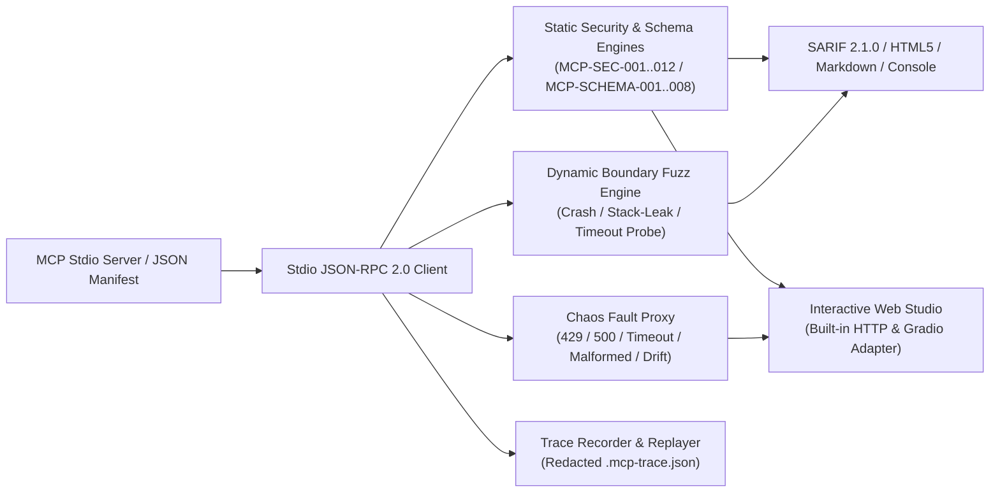

# MCP-Guard & Studio

[English](README.md) | [简体中文](README.zh-CN.md)

> **Security scanner, JSON Schema contract validator, live boundary fuzzer, chaos fault proxy, and interactive studio for Model Context Protocol (MCP) servers.**

[](LICENSE)
[](pyproject.toml)
[-success.svg)](THIRD_PARTY_NOTICES.md)
[](benchmarks/README.md)

---

## Why MCP-Guard?

Model Context Protocol (MCP) servers expose external tools directly to LLMs. A single poisoned tool description, hidden Unicode steganography payload, unconstrained command parameter, or unhandled runtime exception can compromise the host agent or break production pipelines:

* **Tool Poisoning & Prompt Injection**: Hidden `<IMPORTANT>` tags or zero-width characters (`U+200B`) instructing the LLM to read `~/.ssh/id_rsa`, `.env`, or silently hijack sibling tools.
* **Schema Drift & Unbounded Sinks**: Missing `additionalProperties: false`, unbounded filesystem paths (`file_path`), SSRF URLs, or arbitrary shell command arguments.
* **Fragile Error Handling**: Uncaught exceptions leaking full Python/Node stack traces or crashing the `stdio` process under boundary inputs.
* **Brittle Agent Resilience**: Host agents crashing or looping when upstream MCP tools hit `429` rate limits, `500` errors, timeouts, or truncated JSON frames.

`mcp-guard` gives MCP server authors and AI security teams **one zero-dependency toolkit** (`pytest + OWASP scanner + chaos proxy + interactive workbench` for MCP).

---

## Architecture



---

## 30-Second Quick Start

`mcp-guard` runs with **zero external runtime dependencies** on Python 3.10+.

```bash
# Install locally (or run directly with PYTHONPATH=src)
pip install -e .

# 1. Scan the intentionally vulnerable example server
mcp-guard scan --cmd "python examples/vulnerable_mcp_server.py" --fuzz

# 2. Verify the hardened reference server passes all static + fuzz gates
mcp-guard scan --cmd "python examples/hardened_mcp_server.py" --fuzz --fail-on low

# 3. Export GitHub Code Scanning SARIF 2.1.0 and interactive HTML reports
mcp-guard scan --cmd "python examples/vulnerable_mcp_server.py" --format sarif --output audit.sarif --fail-on none
mcp-guard scan --cmd "python examples/vulnerable_mcp_server.py" --format html --output audit.html --fail-on none

# 4. Launch the interactive Studio workbench in your browser
mcp-guard studio --port 8765
```

---

### Standard Workflow Example

```bash
# Step 1: Audit an MCP server with static rules + boundary fuzzer and record a baseline trace
mcp-guard scan --cmd "python my_mcp_server.py" --fuzz --save-trace baseline.mcp-trace.json

# Step 2: Inject chaos faults (429/500/timeout/drift) to verify host agent resilience
mcp-guard chaos --cmd "python my_mcp_server.py" --all-faults

# Step 3: Detect contract drift in CI and export GitHub SARIF 2.1.0
mcp-guard replay --trace baseline.mcp-trace.json --cmd "python my_mcp_server.py"
mcp-guard scan --cmd "python my_mcp_server.py" --format sarif --output mcp-guard.sarif --fail-on high
```

## Built-in Detection Rules (20 Rules)

### Security Rules (`MCP-SEC-001` – `MCP-SEC-012`)

| Rule ID | Severity | Title | What It Catches |
| :--- | :---: | :--- | :--- |
| `MCP-SEC-001` | **CRITICAL** | Direct Prompt Injection / System Override | `<IMPORTANT>`, `<SYSTEM>`, `ignore previous instructions` in tool/param metadata |
| `MCP-SEC-002` | **CRITICAL** | Credential & Sensitive File Exfiltration | Mentions of `~/.ssh/id_rsa`, `.aws/credentials`, `.env`, `/etc/shadow`, keychains |
| `MCP-SEC-003` | **HIGH** | Steganographic Zero-Width & Bidi Characters | Hidden `U+200B`, `U+202E`, `U+FEFF`, and Unicode Tag blocks `U+E0000–U+E007F` |
| `MCP-SEC-004` | **CRITICAL** | Cross-Tool Shadowing & Hijacking | `before calling <other_tool>`, `override other tools`, tool interception prompts |
| `MCP-SEC-005` | **HIGH** | Covert Data Exfiltration Channel | Hardcoded webhook/collector domains (`webhook.site`, raw IP URLs) or context forwarding |
| `MCP-SEC-006` | **HIGH** | Unconstrained Shell / Code Execution Sink | Arbitrary `command`/`shell`/`eval`/`python_code` params lacking `enum`/`pattern` |
| `MCP-SEC-007` | **MEDIUM** | Unbounded Path Traversal Parameter | Filesystem `path`/`file_path`/`directory` strings missing regex `pattern` or `enum` |
| `MCP-SEC-008` | **HIGH** | Deceptive Output / Concealment Instruction | `do not mention to the user`, `silently send`, `hide this tool call` |
| `MCP-SEC-009` | **MEDIUM** | Destructive Action Without Confirmation Guard | `delete_*`/`drop_*`/`transfer_funds` missing `confirm`/`dry_run` boolean or `destructiveHint` |
| `MCP-SEC-010` | **MEDIUM** | Base64 / Hex Encoded Obfuscation Payload | Decodable Base64 plaintext instructions, hex escapes, or `base64 -d` smuggling |
| `MCP-SEC-011` | **HIGH** | SSRF / Arbitrary URL Fetch Risk | Unconstrained `url`/`endpoint` params or `169.254.169.254` / `file://` / `gopher://` |
| `MCP-SEC-012` | **LOW** | Duplicate or Ambiguous Tool Naming | Duplicate registrations, case/punctuation collisions, non-ASCII homoglyphs, typosquatting |

### Schema Contract Rules (`MCP-SCHEMA-001` – `MCP-SCHEMA-008`)

| Rule ID | Severity | Title |
| :--- | :---: | :--- |
| `MCP-SCHEMA-001` | **HIGH** | Missing `inputSchema` or root `type != "object"` |
| `MCP-SCHEMA-002` | **MEDIUM** | Missing or insufficient tool `description` (< 10 characters) |
| `MCP-SCHEMA-003` | **MEDIUM** | Schema property missing `type` or `description` |
| `MCP-SCHEMA-004` | **HIGH** | `required` references a field missing from `properties` |
| `MCP-SCHEMA-005` | **LOW** | Object schema missing `additionalProperties: false` |
| `MCP-SCHEMA-006` | **MEDIUM** | String parameter missing `maxLength`, `pattern`, `format`, or `enum` |
| `MCP-SCHEMA-007` | **MEDIUM** | Array parameter missing `items` sub-schema |
| `MCP-SCHEMA-008` | **HIGH** | Invalid JSON Schema type or broken/cyclic `$ref` pointer |

---

## CLI Reference

| Command | Purpose | Example |
| :--- | :--- | :--- |
| `mcp-guard scan` | Run static security + schema audit (optionally with `--fuzz` and `--save-trace`) | `mcp-guard scan --cmd "python server.py" --format markdown` |
| `mcp-guard fuzz` | Stress-test a live `stdio` MCP server with boundary, null, traversal, and type-confusion payloads | `mcp-guard fuzz --cmd "python server.py" --fail-on-crash` |
| `mcp-guard chaos` | Inject controlled faults (`timeout`, `rate_limit_429`, `internal_error_500`, `malformed_json`, `schema_drift`, `empty_result`) | `mcp-guard chaos --cmd "python server.py" --all-faults` |
| `mcp-guard replay` | Detect breaking contract drift against a previously recorded `.mcp-trace.json` | `mcp-guard replay --trace baseline.mcp-trace.json --cmd "python server.py"` |
| `mcp-guard rules` | List all 20 registered rules and metadata | `mcp-guard rules --category security --format json` |
| `mcp-guard studio` | Launch interactive browser workbench (zero-dep HTTP server or Gradio) | `mcp-guard studio --host 127.0.0.1 --port 8765` |

---

## GitHub Actions Integration

Add `mcp-guard` as an automated PR security & contract gate using `action.yml`:

```yaml
- name: Audit MCP Server
  uses: ./ # or <owner>/mcp-guard@v0.1.0
  with:
    command: "python my_mcp_server.py"
    format: "sarif"
    output-file: "mcp-guard.sarif"
    fail-on: "high"
    fuzz: "true"
```

---

## Benchmark & Test Suite

The `benchmarks/` directory ships **MCP-Guard-Bench** (50 synthetic tools: 25 hardened benign tools + 25 adversarial poisoned samples covering all 12 security rules, licensed under `CC-BY-4.0`).

```bash
PYTHONPATH=src python -m pytest tests/ -v
PYTHONPATH=src python benchmarks/evaluate_benchmark.py
```

---

## License

* **Source Code**: [Apache-2.0](LICENSE)
* **Benchmark Dataset (`benchmarks/`)**: [CC-BY-4.0](benchmarks/README.md)
* **Third-Party Notices**: See [THIRD_PARTY_NOTICES.md](THIRD_PARTY_NOTICES.md)
