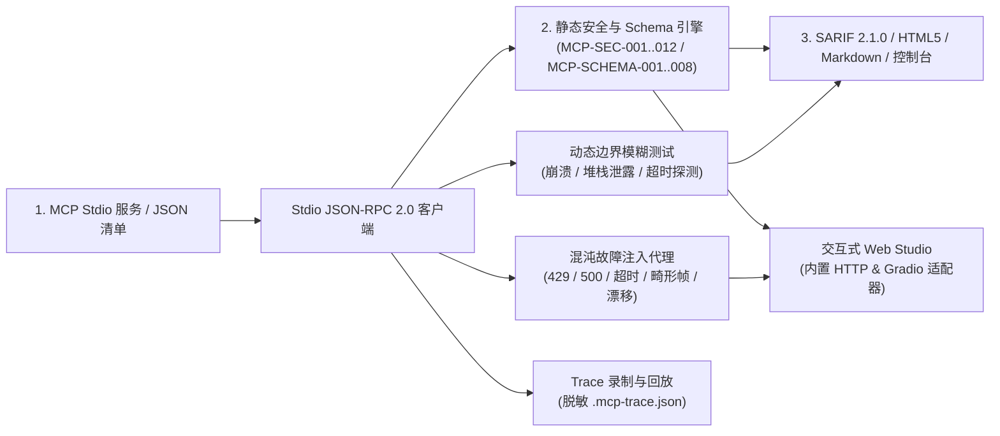

# MCP-Guard & Studio

[English](README.md) | [简体中文](README.zh-CN.md)

> **面向 Model Context Protocol (MCP) 服务端的安全扫描器、JSON Schema 契约校验器、动态边界模糊测试器、混沌故障代理与交互式 Web 工作台。**

[](LICENSE)
[](pyproject.toml)
[-success.svg)](THIRD_PARTY_NOTICES.md)
[](benchmarks/README.md)

---

## 为什么需要 MCP-Guard？

MCP（Model Context Protocol）服务器将外部工具直接暴露给大模型。一条被投毒的工具描述、隐藏的零宽 Unicode 隐写载荷、无约束的命令参数或未捕获的运行时异常，都可能劫持宿主智能体或拖垮生产流水线：

* **工具投毒与提示词注入**：隐藏 `<IMPORTANT>` 标签或零宽字符（`U+200B`），诱导大模型读取 `~/.ssh/id_rsa`、`.env` 或劫持同级工具。
* **Schema 漂移与无界输入槽**：缺少 `additionalProperties: false`、未限制路径遍历（`file_path`）、SSRF URL 或任意 Shell 命令参数。
* **脆弱的错误处理**：未捕获异常泄露 Python/Node 完整堆栈，或在边界输入下直接崩溃退出。
* **智能体容错不足**：上游 MCP 工具出现 `429` 限流、`500` 错误、超时或截断 JSON 时宿主智能体陷入死循环或崩溃。

`mcp-guard` 为 MCP 开发者与 AI 安全团队提供**零外部依赖的一体化测试与审计工具箱**。

---

## 架构与工作流程图



---

## 30 秒快速上手与操作工作流示例

仅需 Python 3.10+，**零第三方运行时依赖**：

```bash
pip install -e .

# 1. 扫描示例中的脆弱 MCP 服务并开启边界 Fuzz
mcp-guard scan --cmd "python examples/vulnerable_mcp_server.py" --fuzz

# 2. 验证加固版参考服务通过全部静态与模糊测试门禁
mcp-guard scan --cmd "python examples/hardened_mcp_server.py" --fuzz --fail-on low

# 3. 导出 GitHub Code Scanning SARIF 2.1.0 与交互式 HTML 报告
mcp-guard scan --cmd "python examples/vulnerable_mcp_server.py" --format sarif --output audit.sarif --fail-on none
mcp-guard scan --cmd "python examples/vulnerable_mcp_server.py" --format html --output audit.html --fail-on none

# 4. 启动交互式 Web Studio 工作台
mcp-guard studio --port 8765
```

典型持续集成与混沌测试工作流：

```bash
# 第一步：录制基线 Trace 并做全量扫描
mcp-guard scan --cmd "python my_mcp_server.py" --fuzz --save-trace baseline.mcp-trace.json

# 第二步：注入 429 / 500 / 超时 / Schema 漂移故障验证容错
mcp-guard chaos --cmd "python my_mcp_server.py" --all-faults

# 第三步：回归回放检测破坏性契约漂移
mcp-guard replay --trace baseline.mcp-trace.json --cmd "python my_mcp_server.py"
```

---

## 内置 20 条检测规则

- **12 条安全规则（`MCP-SEC-001` – `MCP-SEC-012`）**：覆盖直接提示词注入、凭证/敏感文件窃取、零宽/双向隐写字符、跨工具劫持、隐蔽外传通道、无约束 Shell/代码执行、路径遍历、欺骗性隐瞒指令、高危操作缺少确认护栏、Base64/Hex 混淆、SSRF 与重名仿冒。
- **8 条 Schema 契约规则（`MCP-SCHEMA-001` – `MCP-SCHEMA-008`）**：覆盖缺失 `inputSchema`、描述过短、缺少字段类型或说明、`required` 引用不存在字段、缺少 `additionalProperties: false`、字符串缺长度/正则限制、数组缺 `items` 及无效 `$ref`。

---

## CLI 命令速查

| 命令 | 用途 | 示例 |
| --- | --- | --- |
| `mcp-guard scan` | 运行静态安全 + Schema 审计（可选 `--fuzz` 与 `--save-trace`） | `mcp-guard scan --cmd "python server.py" --format markdown` |
| `mcp-guard fuzz` | 使用边界值、空值、路径遍历与类型混淆载荷压测 MCP 服务 | `mcp-guard fuzz --cmd "python server.py" --fail-on crash` |
| `mcp-guard chaos` | 注入 `timeout`、`429`、`500`、`malformed_json`、`schema_drift` 等可控故障 | `mcp-guard chaos --cmd "python server.py" --all-faults` |
| `mcp-guard replay` | 对比基线 `.mcp-trace.json` 检测契约漂移 | `mcp-guard replay --trace baseline.mcp-trace.json --cmd "python server.py"` |
| `mcp-guard rules` | 列出全部 20 条规则与元数据 | `mcp-guard rules --category security --format json` |
| `mcp-guard studio` | 启动浏览器可视化工作台 | `mcp-guard studio --host 127.0.0.1 --port 8765` |

---

## 基准测试与开源协议

`benchmarks/` 内置 **MCP-Guard-Bench**（50 个合成工具：25 个合规加固样本 + 25 个对抗投毒样本，覆盖全部 12 条安全规则，`CC-BY-4.0`）：

```bash
PYTHONPATH=src python -m pytest tests/ -v
PYTHONPATH=src python benchmarks/evaluate_benchmark.py
```

源码协议为 [Apache-2.0](LICENSE)，数据集为 [CC-BY-4.0](benchmarks/README.md)，详见 [THIRD_PARTY_NOTICES.md](THIRD_PARTY_NOTICES.md)。
